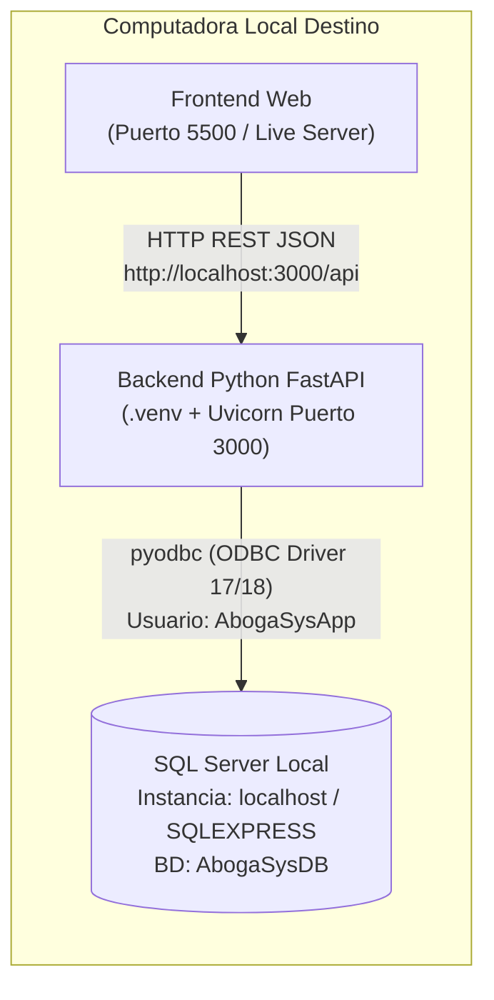

# Manual Técnico de Instalación y Ejecución Local — AbogaSys

Este manual técnico detalla paso a paso cómo trasladar, configurar y ejecutar el sistema **AbogaSys** (Backend **Python FastAPI** + Base de Datos **Microsoft SQL Server** + Frontend **HTML5/JS/TailwindCSS**) en **cualquier otra computadora local**, especificando exactamente qué archivos, configuraciones y variables deben modificarse en el nuevo equipo.

---

## 1. Arquitectura de Despliegue Local



---

## 2. Requisitos Previos en la Nueva Computadora

Antes de iniciar la configuración en otra computadora, asegúrate de instalar los siguientes componentes:

| Componente | Versión Recomendada | Notas de Instalación |
| :--- | :--- | :--- |
| **Sistema Operativo** | Windows 10 / 11 (64 bits) | Con PowerShell o CMD habilitado. |
| **Python** | **Python 3.11, 3.12, 3.13 o 3.14** | Al instalar desde [python.org](https://www.python.org/downloads/), marcar la casilla **"Add python.exe to PATH"**. |
| **Microsoft SQL Server** | **SQL Server 2019 / 2022 / 2025** (Express o Developer) | Debe instalarse en **Modo de Autenticación Mixto** (*SQL Server and Windows Authentication mode*). |
| **SQL Server Management Studio (SSMS)** | SSMS 19 / 20 (o `sqlcmd`) | Para ejecutar los scripts `.sql` de creación de base de datos. |
| **Driver ODBC para SQL Server** | **ODBC Driver 17 for SQL Server** (o Driver 18) | Generalmente se instala junto con SQL Server o SSMS. |

> [!IMPORTANT]
> **¿Por qué no se debe reutilizar la carpeta `.venv` de otra computadora?**
> Los entornos virtuales de Python (`.venv`) guardan rutas absolutas del usuario y de la versión específica de Python de la máquina donde fueron creados (en el archivo `.venv\pyvenv.cfg` y en los ejecutables de `.venv\Scripts\`). Por ello, **cada vez que copies el proyecto a otra computadora, debes eliminar la carpeta `.venv` y volver a crearla** con el Python de esa computadora (ver **Paso 3**).

---

## 3. ¿Qué Debes Cambiar al Pasar a Otra Computadora? (Resumen Rápido)

Cuando copies la carpeta `AbogaSys` a otra PC, **solo necesitas intervenir en 3 puntos**:

1. **En SQL Server (Nueva PC)**:
   - Ejecutar en orden los 3 scripts de la carpeta [`database/`](file:///C:/Users/suare/OneDrive/Desktop/AbogaSys/AbogaSys-web/database):
     1. [`01_crear_base_datos.sql`](file:///C:/Users/suare/OneDrive/Desktop/AbogaSys/AbogaSys-web/database/01_crear_base_datos.sql)
     2. [`02_datos_iniciales.sql`](file:///C:/Users/suare/OneDrive/Desktop/AbogaSys/AbogaSys-web/database/02_datos_iniciales.sql)
     3. [`03_crear_usuario_bd.sql`](file:///C:/Users/suare/OneDrive/Desktop/AbogaSys/AbogaSys-web/database/03_crear_usuario_bd.sql)
2. **En [`backend-python/.env`](file:///C:/Users/suare/OneDrive/Desktop/AbogaSys/AbogaSys-web/backend-python/.env)**:
   - Cambiar la variable `DB_SERVER` por el nombre de la instancia de SQL Server de la nueva computadora (ej. `DB_SERVER=localhost` o `DB_SERVER=localhost\SQLEXPRESS` o el nombre del equipo).
3. **En `backend-python/.venv`**:
   - Borrar la carpeta `.venv` anterior y recrearla con `python -m venv .venv` e instalar `pip install -r requirements.txt`.

---

## 4. Guía Paso a Paso en la Nueva Computadora

### Paso 1: Configurar la Base de Datos en SQL Server

#### 1.1 Verificar cómo se llama la instancia de SQL Server en la nueva PC
Abre **PowerShell** en la nueva computadora y ejecuta:

```powershell
# Ver el nombre del equipo (para instancia predeterminada MSSQLSERVER)
hostname

# Ver los servicios de SQL Server instalados en la PC
Get-Service | Where-Object {$_.Name -like "*SQL*"}
```

- Si el servicio principal se llama **`MSSQLSERVER`**, tu `DB_SERVER` será el nombre que arrojó `hostname` o simplemente `localhost`.
- Si el servicio se llama **`MSSQL$SQLEXPRESS`**, tu `DB_SERVER` será `localhost\SQLEXPRESS` (o `NOMBRE_PC\SQLEXPRESS`).

#### 1.2 Verificar que SQL Server tenga Autenticación Mixta habilitada
1. En **SSMS**, haz clic derecho sobre el servidor (raíz) → **Properties** → **Security**.
2. En **Server authentication**, asegúrate de que esté seleccionado **SQL Server and Windows Authentication mode**.
3. Si lo cambiaste, reinicia el servicio de SQL Server (`Restart-Service MSSQLSERVER -Force`).

#### 1.3 Ejecutar los Scripts SQL en Orden
Puedes ejecutarlos abriéndolos en **SSMS** (y presionando `F5` en cada uno) o directamente desde **PowerShell** usando `sqlcmd`:

```powershell
cd "RUTA_DEL_PROYECTO\AbogaSys-web"

# 1. Crear la base de datos AbogaSysDB, sus 12 tablas e índices
sqlcmd -S "localhost" -C -E -i "database\01_crear_base_datos.sql"

# 2. Insertar catálogos base (Cargos, Roles, 24 Permisos, Materias, Tipos)
sqlcmd -S "localhost" -C -E -i "database\02_datos_iniciales.sql"

# 3. Crear el login/usuario de aplicación 'AbogaSysApp' con contraseña 'AbogaSys!123'
sqlcmd -S "localhost" -C -E -i "database\03_crear_usuario_bd.sql"
```
*(Si usas SQL Express en esa PC, reemplaza `"localhost"` por `"localhost\SQLEXPRESS"`).*

---

### Paso 2: Configurar el Archivo `.env` del Backend Python

Abre el archivo [`backend-python/.env`](file:///C:/Users/suare/OneDrive/Desktop/AbogaSys/AbogaSys-web/backend-python/.env) en un editor de texto (VS Code o Bloc de Notas):

```ini
PORT=3000

# Configuración de Base de Datos SQL Server
DB_USER=AbogaSysApp
DB_PASSWORD=AbogaSys!123
DB_SERVER=YOSTIN
DB_DATABASE=AbogaSysDB
DB_DRIVER=ODBC Driver 17 for SQL Server

# Secreto para firmar los JSON Web Tokens (JWT)
JWT_SECRET=abogasys_super_secret_jwt_key_2026
JWT_EXPIRES_IN=8h

# API Key de OpenAI (Opcional, para el Asistente Jurídico IA)
OPENAI_API_KEY=tu_api_key_de_openai_aqui
```

#### ¿Qué variables debes revisar o cambiar en otra PC?

| Variable en `.env` | ¿Se debe cambiar en otra PC? | Qué valor poner |
| :--- | :---: | :--- |
| `DB_SERVER` | **SÍ (Obligatorio)** | Pon `localhost` (si la instancia es `MSSQLSERVER`), `localhost\SQLEXPRESS` (si es SQL Express), o el nombre de la nueva PC. |
| `DB_DRIVER` | **Solo si la nueva PC tiene otro Driver ODBC** | Por defecto usa `ODBC Driver 17 for SQL Server`. Si la nueva PC solo tiene el Driver 18 instalado, cámbialo a `ODBC Driver 18 for SQL Server`. |
| `DB_USER` / `DB_PASSWORD` | No (si ejecutaste `03_crear_usuario_bd.sql`) | Mantener `AbogaSysApp` y `AbogaSys!123`, a menos que decidas usar otro usuario SQL propio. |
| `DB_DATABASE` | No | Mantener `AbogaSysDB`. |
| `PORT` | No | Mantener `3000` (el frontend apunta por defecto a `http://localhost:3000/api` en [`frontend/js/api.js`](file:///C:/Users/suare/OneDrive/Desktop/AbogaSys/AbogaSys-web/frontend/js/api.js#L6)). |
| `OPENAI_API_KEY` | Opcional | Coloca una clave real `sk-...` si deseas usar el chat de Inteligencia Artificial; el resto del sistema funciona sin necesidad de esta clave. |

> [!TIP]
> **¿Cómo saber qué `DB_DRIVER` tiene instalado la otra computadora?**
> Ejecuta en PowerShell:
> ```powershell
> Get-OdbcDriver | Where-Object {$_.Name -like "*SQL Server*"} | Select-Object Name
> ```
> Copia exactamente el nombre que aparezca (por ejemplo, `ODBC Driver 17 for SQL Server` u `ODBC Driver 18 for SQL Server`) y colócalo en `DB_DRIVER` dentro de [`.env`](file:///C:/Users/suare/OneDrive/Desktop/AbogaSys/AbogaSys-web/backend-python/.env).

---

### Paso 3: Recrear el Entorno Virtual de Python (`.venv`)

Abre una terminal PowerShell en la carpeta [`backend-python`](file:///C:/Users/suare/OneDrive/Desktop/AbogaSys/AbogaSys-web/backend-python) y ejecuta los siguientes comandos para limpiar el entorno de la PC anterior y crear uno nativo para la nueva computadora:

```powershell
cd "RUTA_DEL_PROYECTO\AbogaSys-web\backend-python"

# 1. Eliminar el entorno virtual de la computadora anterior
Remove-Item -Recurse -Force .venv -ErrorAction SilentlyContinue

# 2. Crear un nuevo entorno virtual con el Python instalado en la nueva PC
python -m venv .venv

# 3. Activar el entorno virtual
.\.venv\Scripts\Activate.ps1

# 4. Actualizar pip e instalar todas las dependencias del proyecto
python -m pip install --upgrade pip
pip install -r requirements.txt
```

> [!NOTE]
> Si al ejecutar `.\.venv\Scripts\Activate.ps1` PowerShell muestra un error de políticas de ejecución (*ExecutionPolicy*), ejecuta primero:
> ```powershell
> Set-ExecutionPolicy -Scope Process -ExecutionPolicy Bypass
> ```
> O bien ejecuta directamente el Python del entorno sin activarlo: `.\.venv\Scripts\python.exe`.

---

### Paso 4: Crear el Usuario Administrador Inicial

Con la base de datos creada y el `.env` configurado, inicializa el primer empleado y usuario **Administrador** ejecutando:

```powershell
.\.venv\Scripts\python.exe scripts\init_admin.py
```

El script te pedirá por consola:
- **Correo para el nuevo Administrador** (ejemplo: `admin@abogasys.com`)
- **Contraseña** (ejemplo: `Admin123!`)

Si en algún momento olvidas la contraseña del administrador, puedes restablecerla ejecutando:

```powershell
.\.venv\Scripts\python.exe scripts\reset_admin_password.py
```

---

### Paso 5: Iniciar el Sistema (Servidor Unificado en `http://localhost:3000`)

El backend **FastAPI** ([`backend-python/app/main.py`](file:///C:/Users/suare/OneDrive/Desktop/AbogaSys/AbogaSys-web/backend-python/app/main.py)) ahora sirve automáticamente tanto la API REST (`/api/...`) como todas las pantallas del Frontend (`frontend/`), por lo que **no necesitas abrir dos terminales ni usar dos puertos distintos**.

Tienes dos formas de encender el sistema:

#### Opción A (La más fácil — 1 clic): Doble clic en `INICIAR_SISTEMA.bat`
En la carpeta raíz [`AbogaSys-web/`](file:///C:/Users/suare/OneDrive/Desktop/AbogaSys/AbogaSys-web), haz **doble clic** sobre el archivo [`INICIAR_SISTEMA.bat`](file:///C:/Users/suare/OneDrive/Desktop/AbogaSys/AbogaSys-web/INICIAR_SISTEMA.bat).
- Esto encenderá el servidor en el puerto `3000` y abrirá automáticamente tu navegador en **`http://localhost:3000`**.

#### Opción B: Desde una sola terminal PowerShell
```powershell
cd "RUTA_DEL_PROYECTO\AbogaSys-web\backend-python"
.\.venv\Scripts\python.exe -m uvicorn app.main:app --reload --port 3000
```
Luego abre tu navegador en:
- **Sistema Web (Login)**: **`http://localhost:3000`**
- **Documentación Swagger UI**: **`http://localhost:3000/docs`**

---

## 5. ¿Y si quiero cambiar el puerto del Backend en otra PC?

Si en otra computadora el puerto `3000` estuviera ocupado por otro programa y decides usar, por ejemplo, el puerto `8000`:
1. Cambia `PORT=8000` en [`backend-python/.env`](file:///C:/Users/suare/OneDrive/Desktop/AbogaSys/AbogaSys-web/backend-python/.env) y ejecuta Uvicorn con `--port 8000`.
2. Actualiza la constante `API_BASE_URL` en la **línea 6** de [`frontend/js/api.js`](file:///C:/Users/suare/OneDrive/Desktop/AbogaSys/AbogaSys-web/frontend/js/api.js#L6):
   ```javascript
   const API_BASE_URL = 'http://localhost:8000/api';
   ```

---

## 6. Solución de Problemas Comunes (Troubleshooting)

| Error / Síntoma | Causa Probable | Solución |
| :--- | :--- | :--- |
| `No Python at 'C:\Users\...\Python3XX\python.exe'` | Se intentó usar la carpeta `.venv` copiada de otra PC. | Borrar `.venv` y ejecutar `python -m venv .venv` + `pip install -r requirements.txt` (Paso 3). |
| `[IM002] [Microsoft][Administrador de controladores ODBC] No se encuentra el nombre del origen de datos` | El driver indicado en `DB_DRIVER` no coincide con el instalado en esa PC. | Revisar con `Get-OdbcDriver` si la PC tiene `ODBC Driver 17 for SQL Server` u `ODBC Driver 18 for SQL Server` y actualizar `DB_DRIVER` en `.env`. |
| `[28000] [SQL Server] Login failed for user 'AbogaSysApp'` | No se ha ejecutado `03_crear_usuario_bd.sql` o SQL Server está solo en "Windows Authentication mode". | Ejecutar `database\03_crear_usuario_bd.sql` y habilitar **SQL Server and Windows Authentication mode** en SSMS, luego reiniciar el servicio SQL Server. |
| `[08001] Named Pipes Provider: Could not open a connection to SQL Server` | `DB_SERVER` en `.env` tiene el nombre del equipo anterior o el servicio SQL Server está detenido. | Poner `DB_SERVER=localhost` (o `localhost\SQLEXPRESS`) en `.env` y verificar que el servicio SQL Server esté en estado `Running`. |
| `Error 1934: CREATE INDEX failed because QUOTED_IDENTIFIER is OFF` | Se ejecutó un índice filtrado desde consola sin `QUOTED_IDENTIFIER ON`. | Ya corregido en [`database/01_crear_base_datos.sql`](file:///C:/Users/suare/OneDrive/Desktop/AbogaSys/AbogaSys-web/database/01_crear_base_datos.sql#L196-L202), que ahora incluye `SET ANSI_NULLS ON; SET QUOTED_IDENTIFIER ON;`. |
